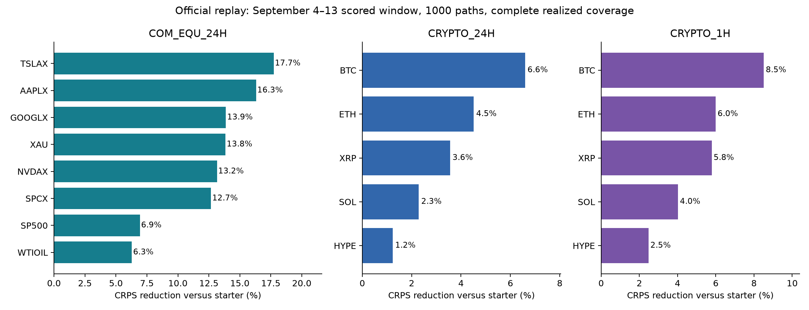

# Seasonal scale matters more than a more complicated price model

## Context

Synth evaluates distributions of simulated prices with CRPS: a forecast must be neither too concentrated nor too diffuse. We tested all three supported configurations and all 13 active assets, ignoring the retired SPYX feed. The starter calibrated independent Gaussian log returns from seven days of minute-close volatility.

All market observations came from the frozen snapshot ending September 14, 2026. There was no online market-price download and no access to another miner's served paths. Historical score/reward APIs were used only to repair a missing comparison bundle, with bounded dates and immediate client-side filtering. Predictions always used context available before issuance.

## Approach

The champion is a small, offline model with three components:

1. **Seasonal scale.** Robust absolute returns estimate a half-hour-of-week activity profile, with shrinkage toward the same hour on weekdays or weekends. This captures the underlying cash-session pattern while recognizing that these perpetual venues trade around the clock.
2. **A heterogeneous autoregression of volatility.** A regularized regression predicts future mean absolute returns from past 15-minute, 1-hour, 6-hour, 1-day, 3-day and 7-day summaries. The target is one hour for minute paths and 24 hours for five-minute paths. This is a HAR-style model; its training loss is a surrogate, while official CRPS decides whether it is useful.
3. **Uncertainty in future scale.** Each path receives a shared lognormal scale multiplier with log standard deviation 0.4 and mean 1. Conditional innovations are Gaussian and antithetic. This gives a sharper center and broader tails than a single Gaussian forecast without adding a fitted directional bet.

Missing prices remain missing. If a short feature window has no observed returns, the model uses a longer observed return scale. An entirely unobserved context cannot supply a starting price and raises a clear error. Every path begins at the last positive observed close, and the model honors the requested path count and grid. All simulation randomness derives from `SYNTH_BENCHMARK_SEED`.

The serving artifact registry contains dated checkpoints through July 20, July 31, August 31 and September 14. A checkpoint is eligible only after its last training minute has closed and before the prompt's issuance time. The final refresh is therefore unavailable at September 15 midnight and first becomes eligible at 00:01 for 1 h and 00:02 for 24 h. September historical replay selects the August 31 checkpoint; no historical prediction uses the September 14 fit.

## Experiments, including failures

Initial development used August 1–7 and August 17–23, with 28 prompts per asset-format per week. Baseline crypto 24 h CRPS was more than twice as high in the second week, providing a useful regime contrast. An unused August 8–16 interval added 72 prompts per asset-format. A separate September 4–13 confirmation used 80 prompts per asset-format. All reported model comparisons use 1000 paths and identical realized observations.

The largest improvement came from modeling session timing for commodities and equities. Five-minute resampling alone explained little of it. Absolute-return scale estimates were less sensitive to isolated jumps, and a learned volatility forecast worked better when paired with uncertainty in future scale. Half-hour profiles improved on hourly profiles; quarter-hour profiles did not help reliably.

The following alternatives failed prespecified promotion thresholds:

- Faster adaptation and blanket volatility shrinkage helped calm conditions but sometimes lost ground in the busier week.
- Learned return drift had positive training R² but worsened held-out CRPS.
- Tree models and a small, GPU-trained neural residual ensemble reduced fitting error without reliable CRPS gains; their busy-window crypto performance was especially weak.
- Extra range/volume features, blockwise future-volatility forecasts, empirical innovations and residual block resampling offered only small or inconsistent gains.
- Fitted return dependence appeared slightly helpful at one seed but reversed with additional seeds. Wider volatility mixtures also lost precision.
- A direct official-CRPS calibration grid on a separate July training week selected values near the existing settings. Its small apparent optimum did not transfer consistently to August.
- An exploratory FOMC-calendar adjustment was not robust across assets and multiplier sizes. It is not in the champion.
- Adding older 2025 crypto history or excluding incomplete final candles did not reliably improve validation.

The journal and prompt-level CSV files preserve the hypotheses, numbers and keep/discard decisions. No field-relative rank was optimized.

## Results

### Full official replay

The table below uses `synth_lib.backtester.orchestration.backtest`, exact validator prompt timestamps, 1000 paths, and 100% realized coverage. The scored-time window is September 4 through September 13, 2026;24 h prompts start one day earlier. There are 1726 commodity/equity, 1080 crypto 24 h and 6480 crypto 1 h prompts per model. Each configuration value is the equal-weight average of its assets' mean CRPS.

| Configuration | Starter CRPS | Champion CRPS | Reduction |
|---|---:|---:|---:|
| CRYPTO_24H | 3851.8626 | 3728.0178 | 3.22% |
| COM_EQU_24H | 2124.4045 | 1854.0901 | 12.72% |
| CRYPTO_1H | 808.1282 | 768.5184 | 4.90% |

Every asset-format improved. Coefficient-weighted CRPS reductions are 13.27% for commodities/equities, 3.61% for crypto 24 h and 5.32% for crypto 1 h. Those are weighted CRPS comparisons, not reward or rank claims.

| Configuration | Asset | Starter | Champion | Reduction |
|---|---|---:|---:|---:|
| COM_EQU_24H | AAPLX | 1862.785 | 1559.030 | 16.31% |
| COM_EQU_24H | GOOGLX | 1595.022 | 1373.684 | 13.88% |
| COM_EQU_24H | NVDAX | 1883.737 | 1635.954 | 13.15% |
| COM_EQU_24H | SP500 | 662.745 | 616.792 | 6.93% |
| COM_EQU_24H | SPCX | 3370.291 | 2943.198 | 12.67% |
| COM_EQU_24H | TSLAX | 2758.436 | 2269.409 | 17.73% |
| COM_EQU_24H | WTIOIL | 3249.470 | 3045.124 | 6.29% |
| COM_EQU_24H | XAU | 1612.751 | 1389.532 | 13.84% |
| CRYPTO_1H | BTC | 499.677 | 457.121 | 8.52% |
| CRYPTO_1H | ETH | 696.899 | 655.119 | 5.99% |
| CRYPTO_1H | HYPE | 1078.096 | 1051.392 | 2.48% |
| CRYPTO_1H | SOL | 860.705 | 826.079 | 4.02% |
| CRYPTO_1H | XRP | 905.265 | 852.880 | 5.79% |
| CRYPTO_24H | BTC | 2421.325 | 2261.693 | 6.59% |
| CRYPTO_24H | ETH | 3304.354 | 3155.180 | 4.51% |
| CRYPTO_24H | HYPE | 5131.843 | 5068.609 | 1.23% |
| CRYPTO_24H | SOL | 4059.138 | 3966.289 | 2.29% |
| CRYPTO_24H | XRP | 4342.653 | 4188.317 | 3.55% |

### Current-rule replay and chronology

The pinned library activates the 1 h volatility component on September 22, after the observation cutoff. Full historical orchestration above correctly uses the rules active on the replayed dates. Separately, the official backtester scorer applied the current published formula to historical observations, without reading future prices. On the ten-day 3 h-grid confirmation, starter versus August 31-fit champion CRPS was:

| Configuration | Starter | Champion |
|---|---:|---:|
| CRYPTO_24H |3561.5627|3399.9605|
| COM_EQU_24H |1920.4177|1646.3891|
| CRYPTO_1H, including volatility |853.3771|805.9141|

Grid and exact-prompt results should not be compared directly: their prompt samples differ, and the grid's mean realized coverage was 98.8718%. Within each comparison, coverage is identical. The official metric was never reimplemented.

Refreshing the same recipe from July 31 to August 31 improved commodity/equity CRPS slightly but worsened crypto by about 0.25–0.32% on the grid. Both checkpoints beat the starter broadly. More recent fitting is not a guaranteed improvement. The September 14 refresh has passed contract and latency checks but cannot have a post-cutoff CRPS measurement within this campaign's permitted data.

Serving checks across all 18 asset-formats generated 1000 valid paths in about 0.02–0.04 seconds per prompt on this hardware, well below the practical 5-second ceiling. Seed reproducibility, arbitrary path counts, raw NaN gaps, a single observed close, and artifact-availability boundaries were checked. Representative September outputs from the simplified serving code were bit-for-bit equal to the validated research implementation.

## Limitations

Overlapping prompts are not independent observations, and one September window cannot establish performance in all regimes. Day-cluster bootstrap checks support the broad baseline improvements, but not tiny differences among near-tied variants. Hyperparameter search across many families can still overfit; this is why weak gains and single-seed effects were rejected.

The seasonal profile is venue-specific and can miss holidays, listing changes and unusual events. Early thin-market data are not equivalent to liquid recent trading. The final model does not model cross-asset dependence, because its serving input contains only one asset's context. It also does not claim that log-price median centering makes arithmetic prices a strict martingale.

The report measures historical CRPS, not the unseen September 15–24 evaluation outcome. The newest artifact refresh is an application of the validated training recipe, not an independently scored future result.

## What we would do with more budget

The most valuable extension would be additional independent regimes and event-level holdouts. The tested complexity families have reached a validation plateau; more tuning on these same weeks risks fitting noise. A future campaign could examine a genuinely different information source available at issuance, or study scheduled-event volatility on a larger, precommitted event sample. The remaining compute budget alone is not evidence that another layer or wider parameter grid will improve expected CRPS.
