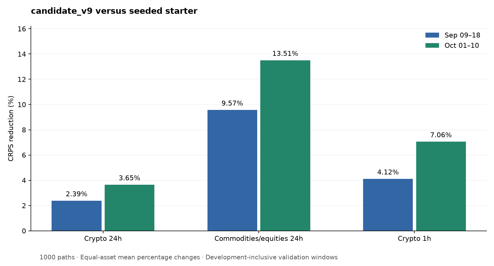

# Calibrating price fans across three Synth competitions

## Context

The selected champion is **v9**, a fast seasonal volatility model with scheduled-event adjustments and configuration-specific sampling. It improves all 36 asset/window cells against the seeded starter in two ten-day comparisons. The largest gains are in commodity and equity perpetuals, where trading-session effects matter substantially.

The objective throughout was official CRPS, not field-relative rank. Every scored experiment used 1,000 paths. All prices came from the supplied snapshot; no prices or outcomes after the October 11 cutoff were consulted. Scheduled events came only from `SYNTH_BENCHMARK_CALENDAR`. The code and raw results include unsuccessful experiments as well as improvements.

The harness issued its landing order at approximately $85 spent and 4.6 hours elapsed. No new experiments were started after that order. A promising late matched-proxy candidate had not completed its required additional-period, historical, and seed checks, so it was not nominated.

## Approach

A constant-volatility fan misses predictable changes in dispersion. The venue trades continuously, but the markets underlying equity and commodity perpetuals have strong sessions. Crypto also has smaller recurring variations within the day and hour.

V9 estimates variance from the supplied seven-day minute context, excluding unavailable return observations rather than interpolating prices. It removes fitted seasonal effects when estimating volatility, then restores the appropriate future seasonal shape. Weekday and weekend profiles use New York local time, including daylight-saving changes. Commodity/equity profiles have ten-minute bins shrunk halfway toward their half-hour parents. Their September 14, October 1, and October 5 refreshes activate only after their respective training cutoffs.

For one-hour crypto, the initial variance combines 15-minute, six-hour, and three-day EWMA estimates with weights 0.60, 0.25, and 0.15. It reverts toward the long estimate with a four-hour half-life. The 24-hour model uses a slower initial estimate and a twelve-hour forward reversion half-life. Commodity/equity variance blends squared returns with a calibrated absolute-return estimator to reduce sensitivity to isolated observations.

Calendar multipliers are fitted with release dates as independent observations. Simultaneous releases combine by maximum rather than multiplication. The selected model uses event power 1.5 and the validated one-minute bar alignment for one-hour forecasts. Missing event types contribute no additional multiplier.

The selected distribution and sampling choices are:

| Configuration | Width multiplier | Path-volatility mixture | Gaussian sampling |
|---|---:|---:|---|
| CRYPTO_24H | 0.95 | None | Ordinary seeded draws |
| COM_EQU_24H | 0.95 | Log standard deviation 0.35 | Scrambled Sobol |
| CRYPTO_1H | 1.00 | Log standard deviation 0.35 | Sobol Brownian bridge |

The mixture has unit expected variance multiplier. The Brownian bridge preserves the intended increment covariance while concentrating important path variation in early Sobol coordinates. It is selected only for one-hour crypto. The seasonal floor is 0.02 for 24-hour forecasts and 0.10 for one-hour forecasts.

Serving reads the benchmark seed on every call and ignores research overrides in `MODEL_CONFIG`. It uses only the supplied price context, committed fitted artifacts, and the environment-provided calendar. No pretrained neural weights are required.

## Experiments and decisions

The journal records hypotheses, settings, results, and decisions for each iteration. Several findings explain the final choice.

**Seasonality and calendar structure provided the main gains.** Seasonality improved every cell in the initial comparisons. Calendar stress tests improved 49 of 54 asset/window cells and all nine configuration/window means. Stronger event kernels subsequently improved 34 of 36 full-window cells. Fine COM profiles, causal refreshes, a lower seasonal floor, and modest narrowing added further gains. The COM floor refinement improved all 24 cells across the main and additional September periods; narrowing improved 13 of 16 main cells and seven of eight additional-period cells.

**Distributional uncertainty helped selectively.** A path-level volatility mixture improved one-hour crypto and COM, but worsened crypto 24-hour results. Student innovations, empirical innovations, blanket narrowing, and several memory changes did not improve consistently. A component audit found that most of the mixture's absolute gain came from price CRPS, despite larger percentage changes in the smaller volatility component.

**Sampling improvements were configuration-specific.** The one-hour Brownian bridge improved 19 of 20 initial cells across two seeds, all ten default-seed full-window cells, all five added-period cells, and all ten causal historical cells. Principal-component Sobol sampling later improved all ten recent crypto 24-hour cells and all fifteen additional/historical default-seed cells. However, it worsened October under both independent seeds 11 and 37. It failed its registered seed criterion and was rejected. Exact covariance preservation alone did not establish a robust finite-fan CRPS improvement.

**Recent neural-model gains did not transfer reliably.** The following are raw equal-asset one-hour CRPS means. Historical tests used artifacts fitted before July and, where necessary, separately fitted historical models.

| Model | Sep09–18 | Oct01–10 | Historical Aug20–21 | Decision |
|---|---:|---:|---:|---|
| Selected v9 | 923.5471 | 690.6868 | 1681.5828 | Retain |
| Chronos-tiny + bridge | 921.9859 | 689.4960 | 1682.3025 | Reject historical reversal |
| TimesFM-1.0-200m + bridge | 922.1419 | 689.3561 | 1682.7293 | Reject historical reversal |
| Chronos-Bolt-tiny median + bridge | 922.0844 | 689.2155 | 1682.5864 | Reject historical reversal |
| Boosted absolute-return residual | 921.8547 | 689.2966 | 1681.8958 | Reject historical reversal |
| Boosted official-loss slope | 922.4810 | 690.1906 | 1684.2893 | Reject temporal checks |

All three pretrained additions improved every recent full-window cell, yet each failed the registered historical August mean criterion. Their serving costs were acceptable: TimesFM took about 0.18 seconds warm on CPU and Bolt about 0.04 seconds for 1,000-path generation. Temporal transfer, rather than latency, prevented selection. Chronos-small, median persistence, and GARCH controls also failed to establish a sufficiently consistent improvement.

**Conditional corrections needed more than a good proxy fit.** A fixed depth-two boosted model improved a chronological August log-width proxy over a matched ridge, and improved all ten recent CRPS cells. Its causal historical refit still regressed August. Symmetric and calm-only adaptive mixtures also failed historical checks. A direct test of Chronos plus symmetric adaptation produced historical August CRPS 1686.2416, worse than v9; this combined failure was measured rather than inferred from the components.

Official-loss supervision was tested without reimplementing CRPS. At exact causal July–August origins, 7,428 official 1,000-path scores supplied finite-difference width-loss slopes. A July-trained tree improved actual August holdout CRPS from 787.3886 to 786.8555. Its subsequent recent gains survived two additional seeds, but the added September raw mean worsened from 922.5773 to 922.6097 and its causal historical refit also failed. The favorable average per-asset percentage change in the added period was not substituted for the unfavorable raw configuration mean.

A matched control clarified attribution: using the same dates, origins, features, and learner, the original absolute-return proxy essentially tied the gradient model on August raw CRPS (786.8545 versus 786.8555). Its refit improved all ten recent cells, with means 922.1880 and 689.5235, and beat the gradient model in eight of ten. This does not establish a deployable improvement: the landing order arrived before its required additional-period, historical, and seed validation. It remains a research candidate.

**Cleaner-looking seasonal fits were not automatically better.** Smoothing neighboring seasonal bins preserved profile means and reduced adjacent-bin variation by about 71%, but worsened all sixteen COM cells. An extra three-day refresh improved September and worsened October. Excluding scheduled-event windows from seasonal fitting worsened fourteen of sixteen cells. Re-estimating event kernels against the fine seasonal background also failed both means, as did the masked-profile-plus-refitted-kernel combination. Explicitly accounting for the age of the latest variance observation produced tiny sign reversals and was rejected.

**The retained 24-hour crypto width has a documented exception.** The 0.95 multiplier improves all twenty full-window cells under two additional seeds, but worsens an older August audit by approximately 0.317% in mean per-asset terms. Across five disjoint default-seed windows, pooled official CRPS falls from 4231.2708 to 4219.2935 over 3,840 prompts. This scalar was retained under its declared pooled-loss and seed-robustness review. Later learned and adaptive candidates faced stricter period-by-period gates. These selection standards differ; the retained width is not universally calibrated.

## Results

All values below come from the official backtester at **1,000 paths and float32 output**. Earlier one-hour prompts use the latest volatility-inclusive scoring formula so the two windows are comparable. Values are equal-asset means within each configuration; reductions are ratios of those raw means.

| Scored days | Configuration | Seeded starter | Champion v9 | Reduction |
|---|---|---:|---:|---:|
| Sep09–18 | CRYPTO_24H | 4296.6726 | 4201.6155 | 2.2123% |
| Sep09–18 | COM_EQU_24H | 2316.0261 | 2080.2779 | 10.1790% |
| Sep09–18 | CRYPTO_1H | 960.4266 | 923.5471 | 3.8399% |
| Oct01–10 | CRYPTO_24H | 3531.2042 | 3406.1522 | 3.5413% |
| Oct01–10 | COM_EQU_24H | 2065.4112 | 1783.6086 | 13.6439% |
| Oct01–10 | CRYPTO_1H | 741.2317 | 690.6868 | 6.8190% |

**All 36 asset/window cells improve.** Prompt counts match in every paired comparison. Canonical sources are `baseline_float32`, `scale95_v5_float32`, `floor02_scale95_v7_float32`, and `bridge_v8_full`. Machine-readable totals and individual cells are in `results/final_comparison.json` and `results/final_comparison_cells.csv`.

The figure averages per-asset percentage reductions, which differs from taking a ratio of configuration means in the table. Both summaries are descriptive; the distinction matters when assets have different CRPS levels.

Final serving checks passed exact reference parity on 36 asset/date/format calls, arbitrary 17-path requests, and 1,000-path contracts. Paths were finite, positive, and started at the last available context price. Repeats were exact and changing the benchmark seed changed the paths. Warm 1,000-path timings were 0.0163 seconds for BTC one-hour, 0.0560 seconds for AAPLX 24-hour, and 0.0578 seconds for XAU 24-hour. The latter contexts contained 3,713 and 898 missing closes. Checks now use the exact official context slice. Results are in `results/final_serving_check.json`.

The ten required serving source/artifact files are tracked and total approximately 0.49 MB. Their hashes are recorded in `results/serving_artifact_manifest.json`. SciPy is already a default transitive dependency through the official scoring packages. Neural-model and sklearn dependencies are not needed by the selected simulator.

## Limitations

These are development-inclusive validation results, not the unseen campaign score. Many hypotheses were compared, and repeated use of the same periods creates selection bias. Twenty-four-hour prompts overlap heavily; prompt count is not independent sample size. Historical and additional-period checks expose counterexamples but do not eliminate this uncertainty.

Seasonal profiles can drift as young perpetual markets mature. Calendar effects have few independent releases, and co-timed events cannot always be identified separately. Snapshot candles and cached validator paths differ in missingness and stale prices. The simulator deliberately does not interpolate missing trades. The selected crypto width's historical counterexample and the differing selection standards are material limitations.

Neural, proxy, and loss-supervised studies sometimes differed in training windows, feature transforms, and aggregation rules. They measure end-to-end utility; they do not establish that one architecture or target is intrinsically superior. The matched-target control was added specifically to address one such confound.

## What we would do with more budget

First, complete the registered temporal and seed checks for the late matched-proxy candidate on fresh periods. Preserve its current settings rather than tuning around the observed failures of related models. Use more independent market regimes and report both raw configuration CRPS and asset-level changes.

For learned forecasts, improve historical regime coverage and validate training-policy updates prospectively. The verified three-step Chronos prefix offers a speed optimization for future studies, but the two tested contexts are not a universal equivalence proof. For calendar work, retain event-date leave-one-out diagnostics and test coherent seasonal/event refits on independent releases.

The nominated model remains the fast, fully validated v9 policy. Research code and rejected artifacts are retained for reproducibility; they do not alter serving through environment configuration.
